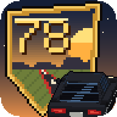
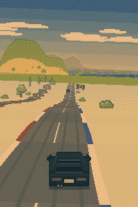

# Scoorohot'78



A retro racing game for Android, drawn the old way: a pseudo-3D road, voxel
cars, and every sprite and sound made by the code itself. The road never ends
and is never the same twice; it is built just ahead of you as you drive.



## On the road

- Seven countries that blend into one another: coast, city, farmland, jungle,
  desert, taiga, savanna.
- Traffic both ways: three lanes each way in town, two on highways, one wide
  lane on dirt tracks. The oncoming carriageway sometimes swings away on its
  own, and can be taken the wrong way.
- Forks with signs. Each road leads to a different country.
- Crossroads with traffic lights, cross traffic and patrol cars. Run a red
  light into a car, or touch a patrol car, and the police come after you.
- Time of day, seasons and weather: rain, snow, fog, night with headlights.
- Hearts on the shoulder that mend the car, and, now and then on a clear
  summer day, wings.
- A car that wears: knocks take their toll, smoke comes, then a cough, then
  silence. Repair it at the pumps, or take another car.
- A fuel tank, and gas stations every few kilometres. Tap the pump button when
  the signs appear and the driver pulls in for you. Change cars at the pumps.
- Sixteen vehicles, a bus, a saucer and a bowling ball among them.
- Things that should not be on a road: rainbow puddles that make you fast,
  black holes that flip the world, a saucer that takes cars away, a wave that
  washes you into a drowned city.
- Rallies, offered now and then while you drive: five kilometres against the
  clock, or three minutes to go as far as you can. Every rally is kept and can
  be driven again on the very same road.

## Controls

- Finger on the screen: the car drives. Lift it and the car rolls to a stop.
- Slide sideways to steer. The steering floats with your finger.
- Drag down to brake. Brake hard at full speed and you spin.

## Building

No IDE and no build system. The build tools of the Android SDK, a JDK and a
platform jar, API 34 or newer, are all it takes:

```sh
export ANDROID_JAR=/path/to/android.jar
export KEYSTORE=/path/to/your.keystore KEY_ALIAS=yourkey KS_PASS=yourpassword
./build.sh
```

The signed package is `out/scoorohot.apk`. It runs on Android 8.0 and newer.

## License

0BSD. Do what you like with it.
